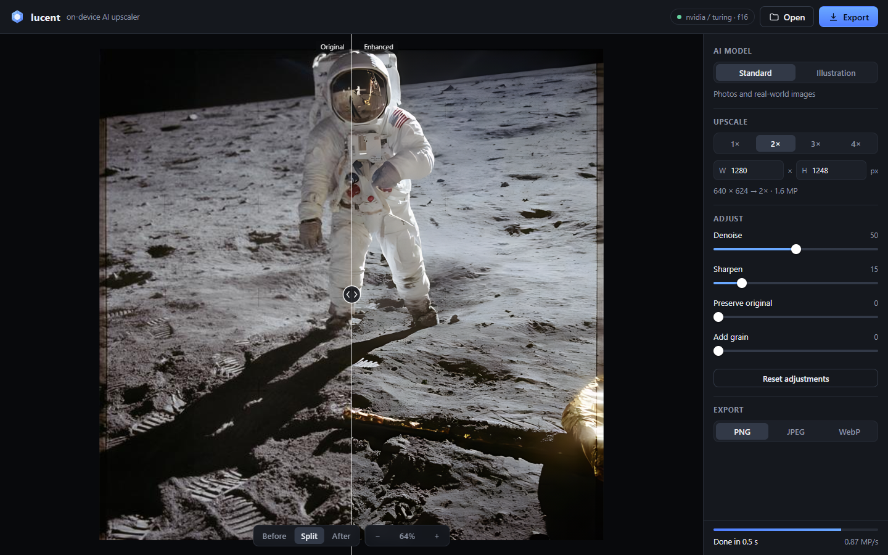
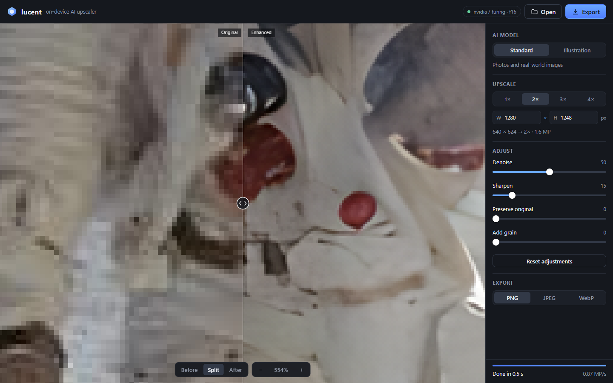

# lucent

**An AI image upscaler and enhancer that runs entirely in your browser, on
your own GPU.** **[Open lucent →](https://lucent-six-hazel.vercel.app)**

Upscale up to 4×, remove noise and recover detail, compare
before/after live, and export. Nothing is uploaded: there is no server.

It runs Real-ESRGAN's compact models on **hand-written WebGPU kernels**:
no ONNX Runtime, no WASM blob, no model server. The whole app is 15 KB of
gzipped JS plus 6 MB of fp16 weights.



## Features

- **AI upscaling, 1×–4×** with presets or an exact output size in pixels.
  1× is pure enhancement (denoise and detail at the original size).
- **Two models.** *Standard* for photos (`realesr-general-x4v3`) and
  *Illustration* for anime, art and line work (`realesr-animevideov3`).
- **Denoise strength** is real network interpolation (Real-ESRGAN's DNI):
  the slider blends the strong- and weak-denoise checkpoints' weights.
- **Sharpen**, **preserve original** (blend toward a bicubic upscale when the
  AI goes too far) and **film grain** (to undo the "plastic" look).
- **Live preview.** Every change re-runs the enhancement, starting with the
  tiles in the centre of your view and painting over the previous result,
  so the image never goes blank.
- **Before/after viewer:** draggable split, zoom at the cursor up to 3200%
  (pixel-exact past 200%), pan, pinch zoom, hold <kbd>Space</kbd> for the
  original.
- **Batch:** drop or paste many images, then *Export all*, straight into a
  folder in Chromium browsers.
- PNG / JPEG / WebP export, alpha kept (bicubic), works on phones.

## How fast

NVIDIA Turing laptop GPU, fp16, measured through the app
([details and method](docs/PERFORMANCE.md)):

| input | output | time |
| --- | --- | ---: |
| 640×624 photo | 4× → 2560×2496 | 0.5 s |
| 2560×2496 (6.4 MP) | 2× → 25.6 MP | 6.9 s |

The conv kernel runs at 3.1 TFLOP/s on that GPU, 5.3× faster than the first
version, through register blocking, weights staged in workgroup memory and
fp16. All of it is in [docs/PERFORMANCE.md](docs/PERFORMANCE.md).

## Accuracy

The GPU path is tested against a deliberately naive CPU implementation of
the network in headless Chromium on a real GPU. fp32 output matches it
exactly (0/255 difference at 4×), fp16 stays within 2/255, and tiled output
stays within 2/255 of untiled output, so there are no visible seams.



## Use it

```sh
npm install
npm run dev        # http://localhost:5173
```

Needs a browser with WebGPU: desktop Chrome / Edge / Brave 113+, Safari 26+,
Chrome on Android. fp16 is used where the GPU supports `shader-f16`, with
fp32 as the fallback.

| shortcut | |
| --- | --- |
| <kbd>Ctrl</kbd> <kbd>O</kbd> / <kbd>Ctrl</kbd> <kbd>V</kbd> | open / paste images |
| <kbd>Ctrl</kbd> <kbd>S</kbd> | export |
| hold <kbd>Space</kbd> | show the original |
| <kbd>F</kbd> / <kbd>1</kbd> / <kbd>+</kbd> <kbd>-</kbd> | fit / 100% / zoom |
| double-click | toggle fit ↔ 100% |

## Development

```sh
npm run typecheck
npm test           # GPU kernel tests in headless Chromium (needs a real GPU)
npm run bench      # conv-kernel tiling × precision sweep
npm run build && npm run smoke   # drive the built app end to end, screenshots in smoke-out/
SMOKE_URL=https://lucent-six-hazel.vercel.app npm run smoke   # same, against a deployment
npm run convert    # re-create public/models/*.safetensors from the upstream .pth files
```

Tests use whichever Chrome, Edge or Brave is installed (`LUCENT_BROWSER`
overrides). Playwright's bundled Chromium only has a software WebGPU
adapter, so the smoke test refuses to run on it.

## How it works

```
image ─▶ tiles (512 px + 24 px context apron)
          │
          ├─ pack            rgba8 texture → fp16 activations
          ├─ SRVGGNetCompact 34 × conv3x3 + PReLU, one dispatch each
          ├─ compose         pixel-shuffle 4× + skip, Lanczos-2 to target
          │                  scale, blend toward bicubic, alpha
          ├─ finish          unsharp mask, grain, rgba8
          └─ readback        double-buffered, nearest-to-view first
```

More in [docs/ARCHITECTURE.md](docs/ARCHITECTURE.md).

## Project layout

```
src/gpu/        WebGPU: device, WGSL generators, network, tiled enhancer
src/model/      safetensors reader, SRVGGNetCompact weights + DNI blend
src/reference/  CPU forward pass the kernels are tested against
src/app/        UI: viewer, controls, queue, export
scripts/        .pth → safetensors converter, end-to-end smoke test
test/, bench/   GPU tests and the kernel sweep
```

## Credits

- Models: [Real-ESRGAN](https://github.com/xinntao/Real-ESRGAN) by Xintao
  Wang et al., BSD-3-Clause. Converted to fp16 safetensors by
  `scripts/convert-weights.mjs`, otherwise unchanged. See
  [THIRD_PARTY_NOTICES.md](THIRD_PARTY_NOTICES.md).
- Sample photo: Buzz Aldrin on the Moon, Apollo 11 (AS11-40-5903), NASA,
  public domain.

## License

MIT for the code in this repository. The model weights keep their
BSD-3-Clause license.
